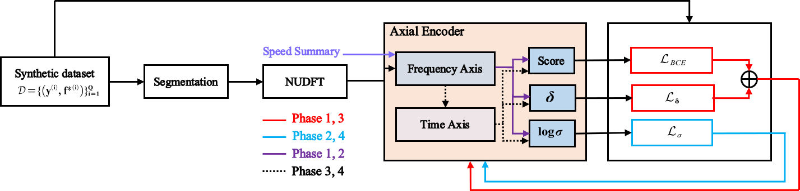

# Simulation-based Inference-aided Variational Line Spectral estimation from Non-uniform Sub-sampled Tip-timing Signals

This repository is used to reproduce the experiments of the proposed method. The method consists of two stages: Simulationed-based inference and Variational inference. Here, we provide the codes to train the neural network in Stage 1 and inference for both stages. The evaluation codes are also included.


## Dependencies

Python 3 + PyTorch + NumPy + TensorBoard 

##  Code Structure

```text
report_code/
├── config.py   — Contain model and experiment configurations.            
├── synthesis_dataset.py  — Generate synthetic datasets.  
├── dataset.py  — Load single-window dataset and prepcoessing            
├── crosswin_data.py  — Prepare cross-window dataset.      
├── encoder.py  — Implement the frequency axis attention on single-window data.          
├── axial_vit.py — Implement the time axis attention on cross-window data.           
├── window_fusion.py — Implement the mean poolng of all windows for unified output.       
├── loss.py — Define training loss functions.                
├── elbo_stage2_tex.py — Implement the variational inference for Stage 2.      
├── peaks.py  — Select the candidate frequency bands for evaluation and Stage 2.              
├── scheduler.py  — Defines learning-rate scheduling utilities.          
├── train_report.py  — Provides the help functions for training scripts.        
├── train_freq_axis.py   — Training script for the frequency-axis (phase 1 and 2).   
├── train_time_axis.py   — Training script for the time-axis (phase 3).   
├── calib_time_axis.py   — Training script for the sigma head of the time axis (phase 4).  
├── infer.py  — Inference script for the two-stage method.               
```

## Brief outline of training in Stage 1
1.The first step in Stage 1 is supervised dataset generation. We generate the data on the fly and the generation is in the training scripts. In Phase 1 and 2, the single-window data generation relies on 'UnifiedBTTDataset' from dataset.py. In Phase 3 and 4, the cross-window data generation relies on 'CrossWinDataset' from crosswin_data.py. The data configuration is in config.py.

2.

The second step is to train the neural network. In total, there are four training phases. In Phase 1 and 3, the sigma heads are frozen and the other components of the neural network are trained. In Phase 2 and 4, only the sigma heads are trained. 

The running of the training is implemente in order: 

### Phase 1
```python
python train_freq_axis.py --stage stage1
```

### Phase 2
```python
python train_freq_axis.py --stage stage2 --stage1_ckpt artifacts/ftf_stage1/best.pt
```

### Phase 3
```python
python train_time_axis.py artifacts/ftf_stage2/best.pt artifacts/ftf_stage2/config.json
```

### Phase 4
```python
python calib_time_axis.py artifacts/axial_vit_frozenfreq/best.pt \
                          artifacts/axial_vit_frozenfreq/config.json
```
The output directories will be create automatically by running the scripts.

## Two-stage Inference
The inference script is infer.py

